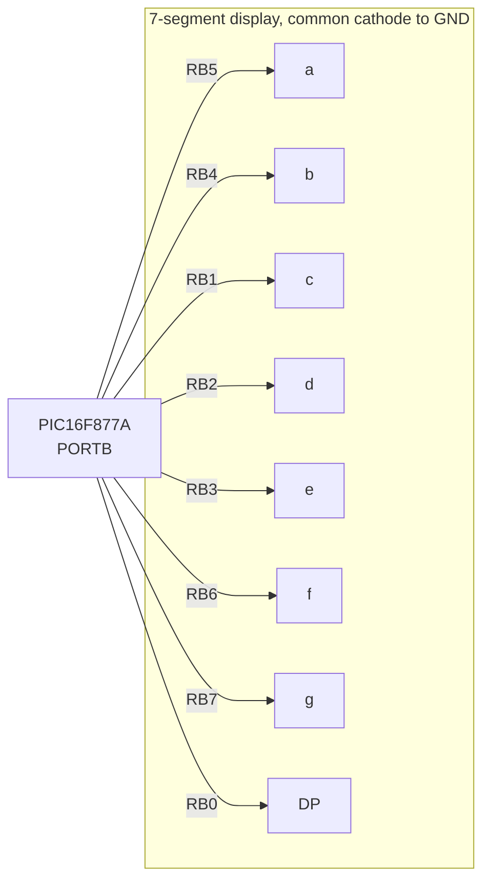
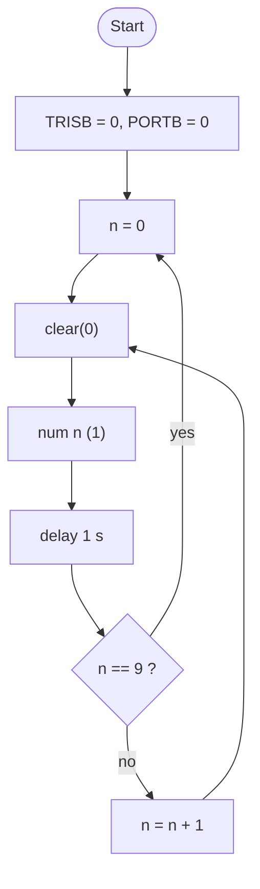

# Microcontroller-7-Segment-Display

Counts **0 → 9** on a single common-cathode 7-segment display driven directly from PORTB of a PIC16F877A, one digit per second.

## Target hardware & settings

| Setting | Value |
|---|---|
| Microcontroller | **PIC16F877A** |
| Clock | 8 MHz crystal (HS) |
| Compiler / IDE | mikroC PRO for PIC |
| Config word | `0x2F4A`: HS oscillator, WDT off, PWRT off, BOR on, LVP off, no code protection |

## Segment wiring

The segments are **not** in the usual a→g order. They follow the board wiring, mapped with `sbit`:

| PORTB bit | RB0 | RB1 | RB2 | RB3 | RB4 | RB5 | RB6 | RB7 |
|---|---|---|---|---|---|---|---|---|
| Segment | DP | c | d | e | b | a | f | g |

A segment lights when its pin is **high**. Put a ~330 Ω resistor in series with each segment.

## How the code works (`MyProject.c`)

| Function | What it does |
|---|---|
| `num0(on)` … `num9(on)` | Sets the segments that form the digit to `on` (1 = light). For example, `num1` sets only **b** and **c**. |
| `clear(0)` | Turns off segments a–g before the next digit is drawn. |
| `main()` | Makes PORTB an output, then loops: `clear` → `numX(1)` → `delay_ms(1000)` for X = 0…9. |

### Notes
- Segment patterns: `num6` includes **e** and `num9` has no **e**, which gives the standard shapes.
- The code repeats each digit by hand. A lookup table would make it shorter:
  `const unsigned char digits[10] = {...}; PORTB = digits[n];`

## Build & flash
Open `MyProject.mcppi` in mikroC PRO for PIC, build, and flash `MyProject.hex`.
